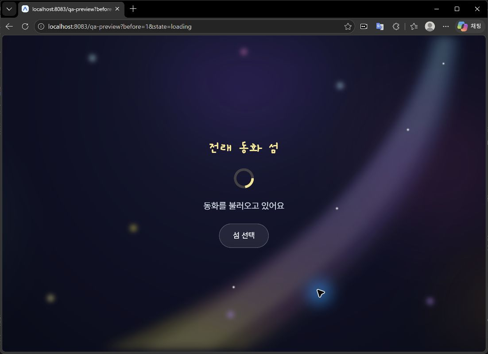
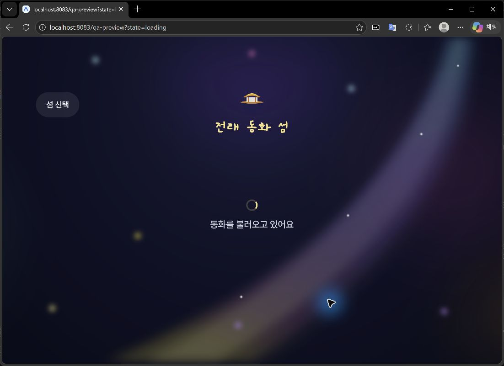

# Issue #54 화면 검증

Expo SDK 58의 실제 화면 컴포넌트를 Edge 웹에서 렌더링한 캡처입니다.
검증용 라우트와 API 응답 대역은 캡처 후 제거했으며 PR에 포함하지 않습니다.
실제 서버 연동 또는 Android/iOS 검증을 대체하지 않습니다.

| 수정 전                       | 수정 후                                   |
| ----------------------------- | ----------------------------------------- |
|  |  |

- 지연 응답: 섬 아이콘·제목·뒤로가기와 배경을 유지하는 로딩 표시 확인.
- 100ms 빈 응답: 빈 책장 및 총 0편 표시 확인. 300ms 미만 로딩 문구 생략은 타이머 구현으로 확인하며, 정밀 영상 측정은 하지 않음.
- 공개 목록: 검증용 동화 6개와 작성자, 별자리 연결선 표시 확인.
- 오류 응답: 실패 안내와 다시 시도 버튼 표시, 버튼 클릭 확인.
- 사용자 제공 Figma 캡처와 상단 섬·제목/여섯 별 배치를 대조. Figma 연결 도구는 파일 접근 권한 오류로 원본 수치 대조 불가.
- Android S24 Expo Go 및 iOS의 작은/큰 화면 동작은 추가 확인 필요.

검사: lint, typecheck, 변경한 8개 TypeScript 파일의 Prettier 통과.
전체 `prettier --check .`는 Windows `core.autocrlf=true`로 체크아웃된 기존 178개 파일의 줄바꿈 때문에 실패.
`prettier --check . --end-of-line auto`는 통과. 무관한 파일 전체 포맷 변경은 포함하지 않음.
