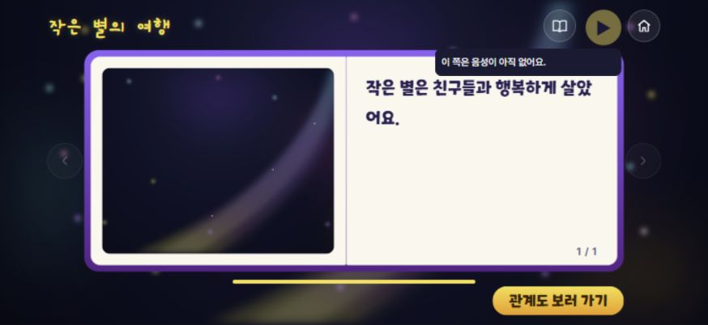
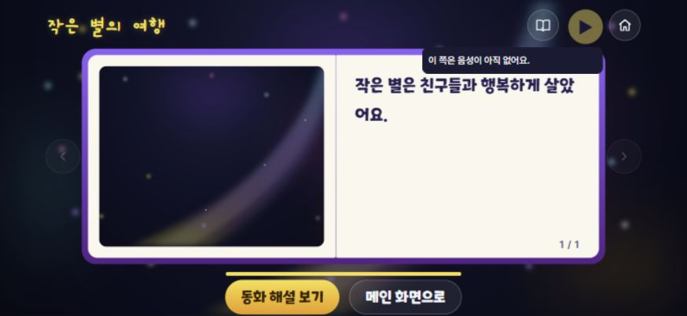

# 읽기 화면 검증

실제 화면 컴포넌트를 임시 QA 라우트에서 렌더링했습니다. QA 라우트는 검증 후 제거했습니다.

| Before                | After               |
| --------------------- | ------------------- |
|  |  |

- 마지막 페이지의 동화 해설 보기 / 메인 화면으로 버튼 표시와 콜백 실행 확인.
- 로컬 WAV를 연결해 재생 종료 후 1/2에서 2/2로 자동 전환되는 것을 웹에서 확인.
- 실제 낭독 음성·서버 생성 완료 및 iOS/Android 실행은 미검증.
- Notion 상세 응답 예시에는 paragraphId가 없습니다. 제공되는 서버는 check→GET을 사용하며, 생략하는 서버는 상세 ttsUrl 재조회로 호환합니다. 페이지 번호나 파일명에서 문단 ID를 추정하지 않습니다.
- API 응답 대역 회귀 검사: node scripts/test-narration.cjs.
- lint/typecheck 통과. 전체 기본 Prettier는 기존 CRLF 파일들에서 실패, --end-of-line auto 검사 통과.
