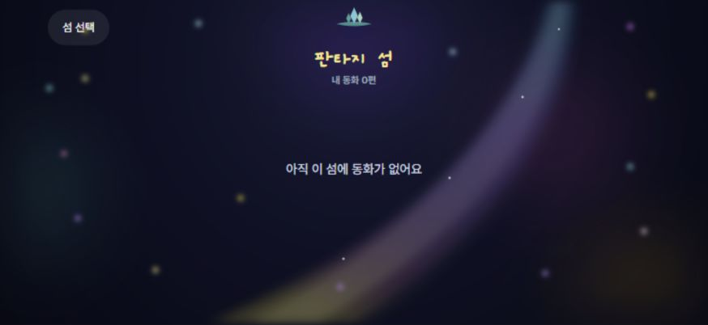
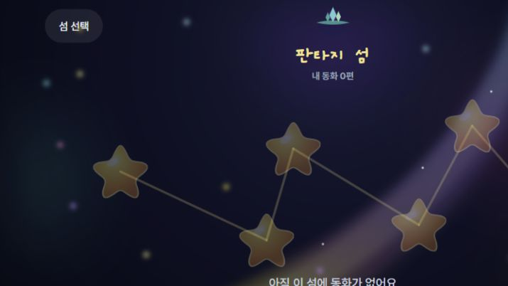

# 책장 화면 검증

동화 0편에서도 여섯 별과 연결선이 표시되는 것을 웹에서 확인했습니다. 667×375 작은 화면에서도 기본 별자리가 표시되었습니다. 빈 별은 접근성 트리의 버튼으로 노출되지 않습니다.

| Before                | After               |
| --------------------- | ------------------- |
|  |  |

After 캡처는 뷰포트 변경 직후의 일부 잘린 화면입니다. 별과 겹치던 빈 목록 안내는 하단으로 옮겼습니다. 최종 고정 뷰포트 재캡처는 브라우저 연결 중단으로 완료하지 못했습니다.

실제 iOS/Android 및 로딩·일부 동화의 시각 검증은 추가 확인이 필요합니다. 임시 QA 파일은 제거했습니다.
